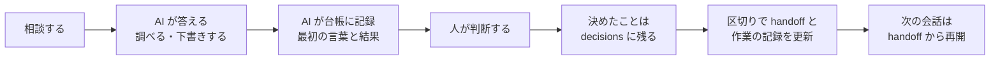

# REI 雛形 v0.3.0-beta.41

**「分からないところが分からない」から始めよう。**
気軽に何でも聞けて、危ないときはちゃんと止めてくれる、先輩みたいな枠組み。

AI（Claude Code）と人が一緒に仕事を進めるための、プロジェクトの雛形です。
台帳（作業・問題・出来事の記録）、引き継ぎのメモ、決めたことの記録、コミット前の点検が最初から入っています。

**まだ試験版（beta）です。** 中身は今後変わることがあります。気になったことは、下の「意見の送り先」へ。

## 考え方

**名前**：REI は「礼」から付けました。立場の違う人と AI が、違いを保ったまま一緒に動くための、最小限の作法という意味です。英語では Relational Exchange Interface の頭文字でもあります。

- **Relational**：よく分からない相手どうしをつなぎ、その関係から始める、という考え方です。初めてのことと人、人と AI、人と道具・定番のやり方・標準・過去の経験、プロジェクトとプロジェクト。互いを全部は分かっていなくても、「何が分からないか分からない」ことも一つの関係として扱い、そこから一緒に動きます
- **Exchange**：一方的に教えるのではなく、交換します。AI が調べて渡し、人が判断して試し、そこで分かったこと・困ったことを記録に残して、次の会話・次の人・別のプロジェクトへ持ち運びます
- **Interface**：中身を後から埋める雛形です（使う人が合わせて変える前提）。REI 自身が標準になるのではなく、標準と人をつなぐ境界面になります

「先輩」は、このつなぎ方が人からどう見えるかのたとえです。「礼」と頭文字は、どちらも同じ重みです。

**何のためか**：初めてのことに出会ったとき、AI が先輩のように、既にあるもの（道具・定番のやり方・公式の決まり・先行例）を先に見せて、自分で判断して進められるようにします。代わりに決めてはくれませんが、「それ、前にもあったよ」「一回書き残しておいた方がいいよ」と、聞かれる前に横から言ってくれる距離感です。途中と最後で危険を拾います。AI が前の会話を忘れても、人の判断が変わっても、記録から再開できます。

**違いは無くさない**：人と AI、慣れた人と初めての人、分野の違う人は、前提も言葉も違います。REI は違いを無くさず、違いを保ったまま一緒に働くための橋渡しをします（異文化のバリアフリー）。

**何のためではないか**：AI に決めさせること。独自の方法論を作ること（定番を探して使い、何を参照したかを書きます）。

**態度は柔らかく、発火は硬い**：何をどう作るか、どの道具を使うかは指図しません。REI が用意するのは「何を知っているか」ではなく「いつ口を出すか」です。口を出す場面のうち、「止めて」と言ったとき・決めたことの書き換え・プロジェクトの外への書き込み・コミット前の点検は、AI の「やりました」という申告に頼らず、hook と点検が機械で確かめます（範囲は下の「限界」）。

**ほかの道具と競わない**：AI と仕事をするための道具や型は、ほかにもたくさんあります（先に仕様を書いてから AI に作らせる型〔仕様駆動〕、開発の段取りを決める型、AI の記憶の道具、課題の管理や決めたことの記録の道具など）。REI にとっては、それらも「既にあるもの」の1つで、競う相手ではなく、つなぐ相手です。目的に合うものを見つけて示し、道具ごとの説明だけでは分かりにくい「どれとどれを組み合わせられるか、どこが重なるか」も一緒に考えます。使うかは人が決めます。ほかの型を使うと人が決めたなら、その型が受け持つところはそちらに任せます。REI が受け持つのは、いつ口を出すか・記録を残すこと・決めるのは人に返すこと、のうち足りないところです。安全と機密の決まりは、どの型と使うときも外しません。

**大事にしていること（4つ）**

1. **共通の作法で動く**：AI への指示（`AGENTS.md`）と方針（`policy.md`）を、毎回最初に読ませる
2. **決めるのは人**：採用・方針・元に戻せない操作は、人に返す
3. **AI は支える**：調べる・下書きする・審査役が判定する。判定で人の判断を置き換えない
4. **記録がよりどころ**：台帳・決めたこと・引き継ぎに残し、次はそこから始める

## 要るもの

- Claude Code（CLI か、エディタの拡張）
- Git（Windows では Git for Windows。hook と点検のスクリプトは Git Bash で動きます）

## 先に知っておくこと：自動で動くスクリプト

この雛形を使うと、`.claude/hooks/`・`.githooks/`・`scripts/` の bash スクリプトが、Claude Code の起動時・AI が道具を使うたび・コミットのたびに自動で動きます。
写す前に中身を一度読んでください（何をするかは `template/docs/security.md`）。外部へ何かを送る処理は入っていません。

## 始め方

1. `template/` フォルダの中身だけを、新しいプロジェクトのフォルダに写す。`.claude/`・`.githooks/` などの隠しフォルダも忘れずに写す
2. そのフォルダで git を始め、コミットの名義を決める

   ```sh
   git init
   git config user.name  "<コミットに残す名前>"
   git config user.email "<コミットに残すメールアドレス>"
   git config core.hooksPath .githooks
   ```

   `core.hooksPath` は、`.githooks/pre-commit` の中身を読んでから設定してください。
   名義を設定しないと、PC 全体の設定（個人の名前・メールアドレスのことが多い）がそのまま履歴に残ります。
   Windows で最初の `git add` のときに `LF will be replaced by CRLF` の警告がたくさん出ますが、無害です。
   macOS・Linux では、`chmod +x .githooks/pre-commit` も実行してください。
   既にあるプロジェクトに入れる手順は、まだ用意していません。同じ名前のファイル（`CLAUDE.md`・`AGENTS.md`・`CHANGELOG.md`・`.claude/settings.json`・`.gitignore`・`.gitattributes` など。`docs/`・`scripts/` のフォルダも）と git の hook の置き場（`core.hooksPath`）がぶつかるので、上書きせず、人と一緒に合わせてください。
3. （任意）個人情報の点検を使うなら、`pii_patterns.example.txt` を見本に、リポジトリの外に表を作る（手順は `docs/howto/pii-check.md`）
4. `AGENTS.md` の末尾「REI本体（親）とフィードバックの送り先」を埋める
5. そのフォルダで Claude Code を起動する。最初に `START.md`（何を作るか・完了条件・外の決まり）を AI と一緒に埋めるところから始まります

あとで REI の新しい版が出たら、作ったプロジェクトを上げられます。新しい雛形で上から写すと、プロジェクトで書き足したところが消えるので、古い雛形と新しい雛形の差分だけを当てます（手順は `template/docs/howto/upgrade.md`、何をするかは `template/scripts/upgrade-plan.sh` で出せます）。公開した版ごとにタグ（`v0.3.0-beta.N`。最初は `v0.3.0-beta.38`）を付けているので、作ったときの版の雛形はタグから取り出せます。

## 始める前に：外の決まり

AI に話した内容、読ませたファイル、コマンドの結果は、AI の提供元に送られます。手元のパソコンの中だけでは完結しません。
`START.md` の「外の決まり」で、始めるときに一度だけ次のことを確かめます。

- 外の AI に渡してよいか（契約・相手先・組織の決まり）、学習に使わない設定になっているか
- 個人情報、ライセンスや素材の権利、守秘義務、法令・規約、AI を使うことの開示、出力を誰が確かめるか

全部に答えなくても始められます。契約や規約を守れないと分かったときは、黙って進めません。進めるかは人が決め、進めるなら何を・なぜ・誰が決めたかを `decisions/` に残し、気をつけて進めます。できれば決まりを定めた側（契約の相手・組織の担当）に確かめるか、伝えます。法令に反すること・人を害することは、この対象に入れません。詳しくは `template/docs/external-rules.md`（法的な助言ではなく、確かめる問いの一覧です）。

## 始めた後の流れ



- 相談するたびに、AI が `ledger/task_log.md` に1行残し、区切りで結果（解決・保留など）を書きます。最初の答えは、記録より先に返します（記録のために人を待たせない。`template/policy.md` の 1.）
- 初めての分野では、AI が先に「その分野の地図」（定番の仕組み・既にある道具）を見せます
- 人の返事を待つときや頼んだことが終わったときに、AI が `handoff.md` の「今どこ」「次の一手」を更新します
- 次の日に新しい会話を始めても、AI は `handoff.md` を読んで続きから始めます

この流れは、`AGENTS.md` と `policy.md` の指示で AI に行わせるものです。機械で確かめてはいません（下の「限界」）。

## 使用例

`examples/` に、雛形を使ったときに何がどう埋まるかの例があります。手で書かずに、雛形を写したフォルダで Claude Code を実際に動かして作りました（`template/` の外にあるので、プロジェクトには写りません）。

- `examples/notice-page-update/`：人が3回話しかけたときの AI の返事と、その後に埋まった台帳・決定・引き継ぎ・作業記録
- `examples/hook-examples.md`：「止めて」、決定ファイルの書き換え、プロジェクトの外への書き込み、コミット前の点検で、何が出るか

AI がうまくできなかったところも、そのまま残しています（`examples/README.md`）。

## 入っているもの（主なもの）

| 場所 | 中身 |
|---|---|
| `CLAUDE.md` | 起動時に `GOAL.md`・`policy.md`・`AGENTS.md` を読み込む入口 |
| `GOAL.md`・`policy.md`・`AGENTS.md` | 目的・共通の方針・AI の手順 |
| `START.md`・`handoff.md` | 着手前のチェック・引き継ぎのメモ |
| `ledger/` | 台帳（作業・問題・出来事）と日々の作業記録 |
| `decisions/` | 決めたことの記録（書き換えず、覆すときは新しい番号で） |
| `docs/` | 分からないことの進め方、外の決まり（external-rules）、用語、決まった手順（howto）、困ったとき（troubleshooting）、リポジトリとブランチの名前（naming）、記録と実装のリポジトリの分け方（repos） |
| `_inbox/`・`_archive/` | 受け取った資料の置き場と、処理した後の保管場所（中身は git に入れない） |
| `.claude/hooks/` | Claude Code の hook（「止めて」で止まる、決定ファイルの書き換え・プロジェクトの外への書き込みの確認など） |
| `.claude/agents/reviewer.md` | 完了・公開の前に判定させる審査役 |
| `.claude/skills/rei/`・`scripts/rei-status.sh`・`.claude/statusline.sh` | `/rei`：REI の状態（版、新しい版、版上げの試し）を見て、次にすることを選ぶメニュー。ステータスラインは付けるかを人が選ぶ |
| `.rei/` | 受け取りの記録（どの版をいつ受け取ったか）と、ファイルの持ち主の表。版を上げるときの土台 |
| `.githooks/pre-commit`・`scripts/` | コミット前の点検（決定ファイルの書き換え、見えない制御文字、個人情報、受け取りの記録）。版上げの道具（`upgrade-plan.sh`＝何をするかの一覧、`upgrade-try.sh`＝別の作業フォルダで試す） |

## 点検の試し方

Git Bash で（Windows の PowerShell やコマンドプロンプトから `bash` を打つと、Git Bash とは別の bash が動くことがあります）：

```sh
bash scripts/test-check-pii.sh
bash scripts/test-check-control-chars.sh
```

1つ目は「合格 28 / 不合格 0」、2つ目は「全部期待どおり」と出れば動いています。

## 限界（正直に）

- hook と点検は「確認を求める・止める」仕組みで、`git commit --no-verify` などで回避できます。強制ではありません
- Claude Code 以外の AI の道具では、`.claude/hooks/` は動きません（`.githooks/` の点検はコミット時に動きます）
- 機械で止める・確認を求めるのは、「止めて」と言ったとき、決めたことの記録（`decisions/`）の書き換え、プロジェクトの外への書き込み、コミット前の点検（決定の書き換え・見えない制御文字・個人情報・受け取りの記録）だけです。台帳への記録や引き継ぎの更新は、AI への指示（規約）で、守られているかは機械では見ていません。長い会話では抜けることがあるので、区切りで台帳と `handoff.md` を見てください
- 個人情報の点検は、リポジトリの外の表に登録した語だけを止めます。登録していない名前やメールアドレスは止まりません
- プロジェクトの外への書き込みの確認（`scope-guard.sh`）は、Edit・Write の書き込み先だけを見ます。Bash のコマンドでの書き込みは見ません。シンボリックリンクは辿りません
- 既にあるプロジェクトに入れる手順は、まだありません（上の「始め方」）
- REI は、それまでの「つなぎ」（仮のもの）です。AI の道具そのものが、聞かれる前に知らせる・AI の申告ではなく事実で確かめる、を標準で備えるようになったら、REI を使い続けずに、そちらへ乗り換えてください。全部を一度に替えなくても、部分ごとに替えられます（下の「乗り換えるとき」）

## 乗り換えるとき

REI は、いずれ要らなくなってよいものとして作っています。部分ごとに次のようになったら、その部分は REI のものを外して乗り換えられます。外すかは人が決めます。括弧の中の名前（`stop-guard` など）は `template/docs/naming.md`「REI の機能の名前」と同じです。

| REI の部分 | 乗り換えてよいとき |
|---|---|
| 「止めて」で止まる（`stop-guard`）、決めたことの記録の書き換えの確認（`decisions-guard`）、プロジェクトの外への書き込みの確認（`scope-guard`） | 使っている AI の道具が、同じことを標準で備え、AI の申告ではなく事実で確かめるようになったとき |
| コミット前の点検（`commit-checks`） | 点検ごとに、同じものを確かめる道具を入れたとき（1つずつ替えられます。受け取りの記録の点検は、REI の版上げを使う間は残します） |
| 台帳・決めたことの記録・引き継ぎ（`ledger/`・`decisions/`・`handoff.md`） | 課題の管理・決めたことの記録・引き継ぎに、ほかの道具を使うと決めたとき。中身はふつうの Markdown なので、読める形で残り、写せます（乗り換え先の形に合わせる手直しは要ります） |
| 分野の地図（`docs/domains/`） | もっと良い一覧が見つかったら、まず地図に1行足します。地図そのものを外すのは、人が残したものの移し先を決めてから |
| 起動のときの知らせ（`session-notices`：人が渡した資料・`_inbox`・止めた印・REI の新しい版） | 資料と止めた印の知らせを、AI の道具が備えたとき。ただし REI の新しい版の知らせと `/rei` はこの部分に頼っているので、REI のほかの部分を使っている間は残します |

- 外すときは、`.claude/settings.json` のその部分の登録を消します（「止めて」は `stop-request.sh` と `stop-guard.sh` の2つ、決めたことの記録の書き換えは `decisions-guard.sh` と `decisions-bash-guard.sh` の2つ）。スクリプトのファイルは残してかまいません（登録が無ければ動きません）。ファイルも消すなら（`lib/` の下は、ほかの hook も使うので消しません）、版を上げるたびに「確かめる」に出ないよう、ファイルごとに受け取りの記録に `[skip]` を書きます（`template/docs/howto/upgrade.md`「受け取らないファイル」）
- コミット前の点検を1つ外すときは、その `scripts/check-*.sh` を消します（`.githooks/pre-commit` は、ファイルの無い点検を飛ばします）。git の hook を管理する道具を入れるときは、その道具が `core.hooksPath` を書き換えると REI の点検が全部動かなくなるので、残す点検をその道具から呼ぶようにします
- `AGENTS.md`・`policy.md` の、外した部分に触れている行も直します（そのままだと、AI は無い仕組みを前提に動きます）
- 外したことと理由を `decisions/` に残します（`decisions/` そのものを乗り換えたときは、乗り換え先に）
- 道具の機能に置き換えにくいのは、「分からないところが分からない」から始めて、聞かれる前に横から言い、決めるのは人に返す、という構えの部分です。それも要らなくなって REI 全体を外すときは、`CLAUDE.md` の3つの読み込み、`.claude/settings.json` の hook の登録、git の hook の置き場（`git config --unset core.hooksPath`。`.githooks` を指しているときだけ。ほかの道具が使っているなら外さない）を外し、`AGENTS.md`・`policy.md` は消すか、乗り換え先に合わせて書き直します。記録（`ledger/`・`decisions/`）は残せます


## 意見の送り先

このリポジトリの Issues へ。版ごとの変更は `CHANGELOG.md`。

## ライセンス

MIT（`LICENSE`）
